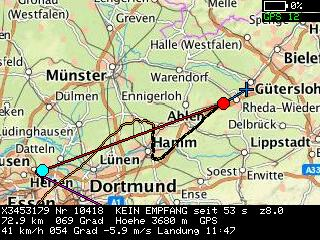
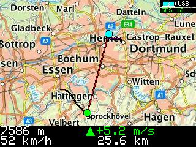
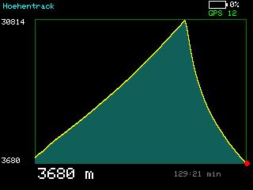
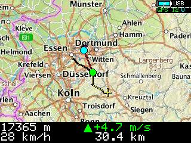
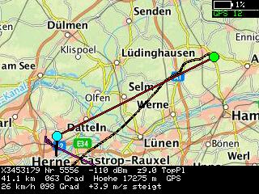
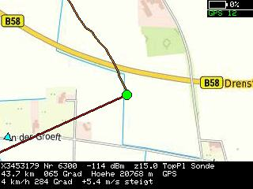
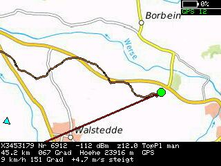
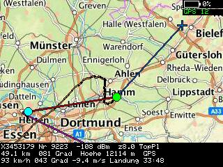

# T-Deck RS41 – Wettersonden-Empfänger & LoRa-APRS-Tracker

Firmware für den [LilyGO T-Deck Plus](https://lilygo.cc/en-us/products/t-deck-plus-1?srsltid=AU7gw4XTKNjTB_l7i5qSKFlh0Ql-kE6qLw8yG6WAu95MsKPBSIrkMjWZ) (ESP32-S3, SX1262-Funkmodul),
die das Gerät in zwei Betriebsarten verwandelt:

- **Sondenempfang**: empfängt und dekodiert Vaisala-RS41-Wettersonden (433 MHz, FSK) direkt über
  den integrierten SX1262 => Position, Höhe, Steig-/Sinkrate und ID live auf der Karte, inklusive
  Landevorhersage beim Sinken.
- **LoRa-APRS**: eigenständiger APRS-Tracker/Empfänger auf 433,775 MHz (europäische LoRa-APRS-Konvention),
  zeigt gehörte Stationen auf der Karte, sendet die eigene Position als Beacon (SmartBeaconing-artig nach
  Tempo getaktet) – ganz ohne Internetverbindung, rein über Funk.

Kein zusätzliches Board, kein Zusatzmodul: läuft komplett auf der im T-Deck Plus verbauten Hardware
(Display, Tastatur, Trackball, GPS, SD-Karte, Akku).

## Features

- RS41-Dekodierung inkl. CRC-Prüfung, GPS-Zeit/-Position/-Höhe, Steig-/Sinkrate, Landevorhersage (lokal und
  optional online per Tawhiri/SondeHub-Windvorhersage)
- Kartenansicht mit mehreren Kartenarten (Rad-/Luftbild-/Topo-/Relief-Kacheln), eigenem Track, Zoom und
  Fokus-Automatik (Sonde+Ich+Landung / Sonde+Ich / Sonde / Ich)
- GPS-Radar-Ansicht: Polarplot der einzelnen Satelliten (Azimut/Elevation) zur Empfangsdiagnose
- Höhentrack-Diagramm (Sondenmodus) bzw. Stationsliste mit Entfernung/Alter (LoRa-Modus), inkl. Einzelstations-
  Fokus auf der Karte
- LoRa-APRS: Empfang (inkl. komprimiertes Positionsformat), eigener Beacon mit automatischem
  Symbol-Wechsel nach Tempo (Stationär/Fußgänger/Fahrrad/Bus), Digipeating
- Sondenfund-Meldung per SondeHub-API (inkl. Freitext-Fundbericht), automatische Weiterleitung zu
  radiosondy.info
- GPX-Aufzeichnung (eigene Position + Sonde), Screenshots mit EXIF-Koordinaten, SD-Kartenlog mit
  GPS-/Akku-Diagnosedaten
- Weboberfläche: Live-Bild des Displays, vollständige Fernsteuerung aller Menüpunkte, Screenshot-/Log-Download
- Firmware-Update per WLAN (ArduinoOTA) ohne USB-Kabel, sobald einmal per USB geflasht

## Hardware

- [LilyGO T-Deck Plus](https://lilygo.cc/en-us/products/t-deck-plus-1) (ESP32-S3, SX1262, GPS, Akku, Tastatur, Trackball)
- MicroSD-Karte (Screenshots, GPX, Logs, Kartenkacheln)

## Kartenkacheln vorbereiten

Die Karte braucht vorab heruntergeladene Kacheln auf der SD-Karte, je Kartenart ein Ordner im Format
`<ordner>/<z>/<x>/<y>.png` bzw. `.jpg` (z. B. `tiles/14/8529/5503.png`):

| Kartenart | Ordner |
|---|---|
| Basiskarte (OpenCycleMap) | `tiles` |
| Luftbild | `tiles_sat` |
| Topografisch | `tiles_topo` |
| TopPlusOpen | `tiles_topplus` |
| Geländeschummerung | `tiles_relief` |

**Wichtig:** Zum Herunterladen die Kacheln zuerst auf eine normale, deutlich schnellere Festplatte/SSD
schreiben (nicht direkt auf die SD-Karte) – Millionen einzelner kleiner Dateien erzeugen auf der SD-Karte
einen so großen Overhead (Dateisystem-Overhead, langsame wahlfreie Schreibzugriffe), dass der Download dort
unnötig lange dauert oder sogar abbricht. Erst nach dem Packen mit `pack_tiles.py` (siehe unten) landen nur
noch die wenigen Bundle-Dateien auf der SD-Karte.

### Herunterladen mit QGIS (Windows und macOS)

[QGIS](https://qgis.org) ist kostenlos, quelloffen und läuft identisch unter Windows, macOS und Linux –
dieselben Schritte funktionieren also auf beiden Systemen, ohne Zusatz-Plugin.

1. QGIS installieren ([qgis.org/download](https://qgis.org/download)).
2. Je Kartenart über Layer → Datenquellen-Verwaltung → WMS/WMTS → "Neu" eine Verbindung mit der
   passenden GetCapabilities-URL anlegen, verbinden und das gewünschte Tileset/Layer aus der Liste
   auswählen (Reiter "Layers"/"Tilesets"):

   | Kartenart | Ordner | GetCapabilities-URL | Layer |
   |---|---|---|---|
   | Luftbild | `tiles_sat` | `https://www.wms.nrw.de/geobasis/wms_nw_dop?REQUEST=GetCapabilities&SERVICE=WMS` | `nw_dop_rgb` (DOP Farbe) |
   | Topografisch | `tiles_topo` | `https://www.wms.nrw.de/geobasis/wms_nw_dtk?SERVICE=WMS&REQUEST=GetCapabilities` | `nw_dtk_col` |
   | Geländeschummerung | `tiles_relief` | `https://www.wms.nrw.de/geobasis/wms_nw_dgm-schummerung?REQUEST=GetCapabilities&SERVICE=WMS&VERSION=1.3.0` | `nw_dgm-schummerung_col` |
   | TopPlusOpen | `tiles_topplus` | `https://sgx.geodatenzentrum.de/wmts_topplus_open/1.0.0/WMTSCapabilities.xml` | `web` (WEBMERCATOR) |

   Die drei NRW-Dienste (Luftbild/Topo/Relief) stammen von Geobasis NRW ([bezreg-koeln.nrw.de](https://www.bezreg-koeln.nrw.de/geobasis-nrw/webdienste/geodatendienste)),
   sind kostenlos und ohne Registrierung nutzbar (Open-Data, nur außerhalb NRW ggf. andere Landesdienste
   nötig). TopPlusOpen ist deutschlandweit und kommt vom BKG.
3. Verarbeitungswerkzeugkiste (Menü Verarbeitung → Werkzeugkiste) → "Rasterwerkzeuge" →
   "XYZ-Kacheln generieren (Verzeichnis)": die geladene WMS/WMTS-Ebene als Quelle wählen, gewünschten
   Kartenausschnitt (Ausdehnung) und Zoombereich einstellen, als Ausgabeverzeichnis direkt den jeweiligen
   Ordner von der SD-Karte angeben (`tiles`, `tiles_sat`, …) – das Werkzeug legt die `z/x/y.png`-Struktur
   automatisch an.
4. Attribution/Nutzungsbedingungen der jeweiligen Quelle beachten (© Geobasis NRW bzw. © GeoBasis-DE / BKG).


### Kacheln fürs T-Deck packen (`Tools/pack_tiles.py`)

FAT32 (Dateisystem der SD-Karte) verwaltet jeden Ordner als lineare Liste und belegt pro Datei mindestens
einen ganzen Cluster – bei Millionen einzelner Kachel-Dateien wird das Suchen langsam und der Speicherbedarf
explodiert. [`Tools/pack_tiles.py`](Tools/pack_tiles.py) packt die heruntergeladenen `z/x/y`-Kacheln pro
Zoomstufe in wenige Bundle-Dateien (`.tb`) plus eine sortierte Index-Datei (`.tbi`), in der der Sketch per
Binärsuche nachschlägt. Reine Python-Standardbibliothek, kein zusätzliches Paket nötig. Das Packen läuft
auf der lokalen Festplatte/SSD, auf der die Kacheln heruntergeladen wurden – erst danach die fertigen
Bundle-Dateien auf die SD-Karte kopieren:

```
python3 Tools/pack_tiles.py ~/kartenkacheln/tiles --verify
python3 Tools/pack_tiles.py ~/kartenkacheln/tiles_sat ~/kartenkacheln/tiles_topo \
    ~/kartenkacheln/tiles_relief ~/kartenkacheln/tiles_topplus \
    --min-size 2048 --verify
```

`--min-size` lässt leere/Rand-Kacheln (z. B. bei Luftbild/Topo/Relief außerhalb der Abdeckung) aus dem
Bundle raus — fehlt eine Kachel, fällt der Sketch automatisch auf die Basiskarte zurück. `--verify` liest
nach dem Packen Stichproben zurück und vergleicht sie byteweise mit dem Original. Erst wenn das sauber
durchläuft, die ursprünglichen `z/x/y`-Ordner von Hand löschen oder das Skript mit `--delete-source` erneut
laufen lassen. Die Ausgabe landet standardmäßig in einem `bundles`-Unterordner neben den Quellordnern (per
`--out-subdir` änderbar) – nur dessen Inhalt muss anschließend auf die SD-Karte (z. B. `/Volumes/T-DECK/tiles`)
kopiert werden. Alle Optionen: `python3 Tools/pack_tiles.py --help`.

## Flashen

1. `config.h.example` im Sketch-Ordner nach `config.h` kopieren und dort eigenes Rufzeichen sowie
   eigene Heimat-Koordinaten eintragen
2. Einmalig per USB mit der Arduino-IDE flashen. Board- und Werkzeuge-Einstellungen (Arduino IDE 2.3.10):

   | Einstellung | Wert |
   |---|---|
   | Board | ESP32S3 Dev Module |
   | USB CDC On Boot | Enabled *(sonst kein Serial-Log über USB-C)* |
   | CPU Frequency | 240MHz (WiFi) |
   | Core Debug Level | None |
   | USB DFU On Boot | Disabled |
   | Erase All Flash Before Sketch Upload | Disabled |
   | Events Run On | Core 1 |
   | Flash Mode | QIO 80MHz |
   | Flash Size | 16MB (128Mb) |
   | JTAG Adapter | Disabled |
   | Arduino Runs On | Core 1 |
   | USB Firmware MSC On Boot | Disabled |
   | Partition Scheme | 16M Flash (3MB APP/9.9MB FATFS) |
   | PSRAM | OPI PSRAM |
   | Upload Mode | UART0 / Hardware CDC |
   | Upload Speed | 921600 |
   | USB Mode | Hardware CDC and JTAG |
   | Zigbee Mode | Disabled |

3. Danach: WLAN im Menü (Taste `W`) mit dem Heimnetz verbinden (Menü `E` für SSID/Passwort) – das Gerät
   taucht dann unter Werkzeuge → Port als Netzwerkport auf (ArduinoOTA, kein Passwort nötig).

## Bedienung (Kurzreferenz)

- **Space / Trackball-Klick**: Ansicht wechseln (Text → Karte → Höhentrack/Stationen → GPS-Radar)
- **Enter**: Konfigurationsmenü
- **A/D** bzw. **O/P**: Kartenzoom (links-/rechtshändig)
- **R** (in der Karte): automatischen Fokus weiterschalten; **R** im Stationsinfo-Popup der Stationsliste:
  Karte mit Fokus auf genau diese Station öffnen
- **Q**: Sondenfund melden / geordnetes Herunterfahren (je nach Kontext)
- **C**: Screenshot

Vollständige Tastenbelegung und Menüpunkte: Kopfkommentar in `tdeck_rs41_v2.ino`.

## Screenshots

### Sondenmodus

  

Kartenansicht mit Flugbahn und Landevorhersage (links/Mitte) und Höhentrack-Diagramm des Aufstiegs (rechts).

<details>
<summary>Weitere Sondenmodus-Screenshots</summary>

  
 

</details>

### LoRa-APRS-Modus

  

Gehörte Stationen auf der Karte (Übersicht und Einzelstations-Fokus) sowie die Stationsliste mit Entfernung
und Alter.

<details>
<summary>Weitere LoRa-APRS-Screenshots</summary>

  

Stations-Detailpopup, GPS-Radar (Empfangsdiagnose der einzelnen Satelliten) und die Textansicht (hier noch im
Sondenmodus-Frequenzbereich, Anzeige ist in beiden Modi gleich aufgebaut).

</details>

## Status

Aktive Hobby-Entwicklung, läuft im Feldeinsatz (Fuß/Fahrrad/Auto, Sondenjagd). Siehe Versionskommentare im
Quelltext für die laufende Änderungshistorie.

## Lizenz

GNU GPLv3, siehe [LICENSE](LICENSE).

## Autor

DL6TJ
